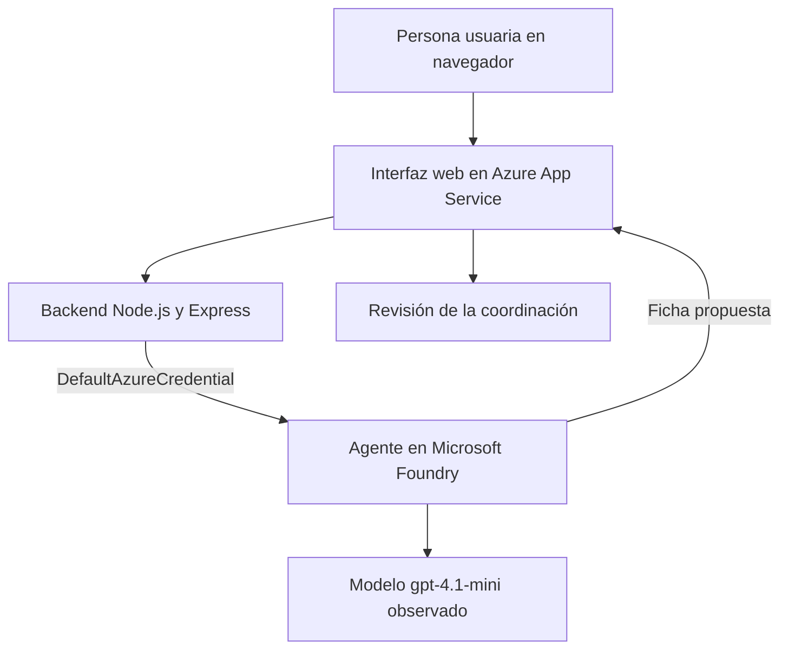
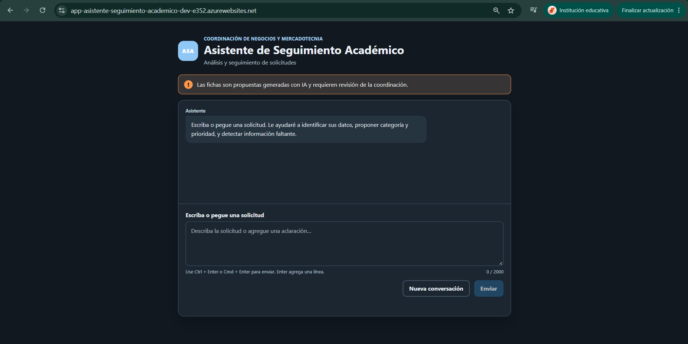
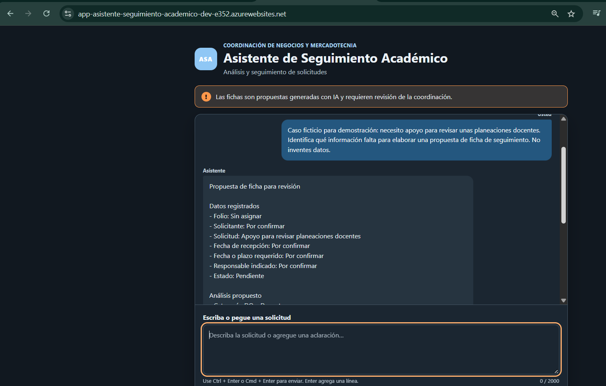
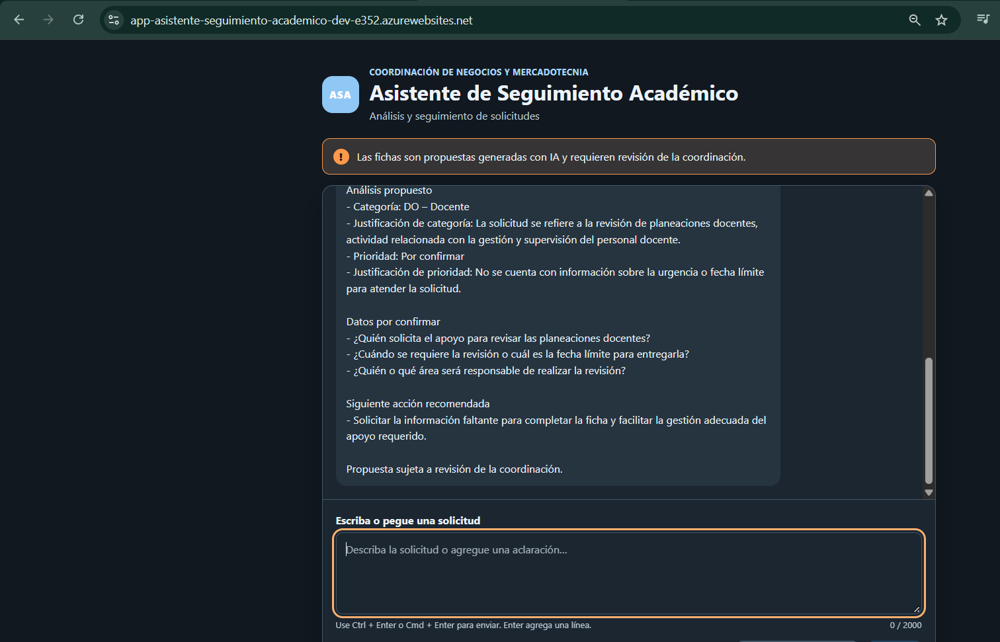
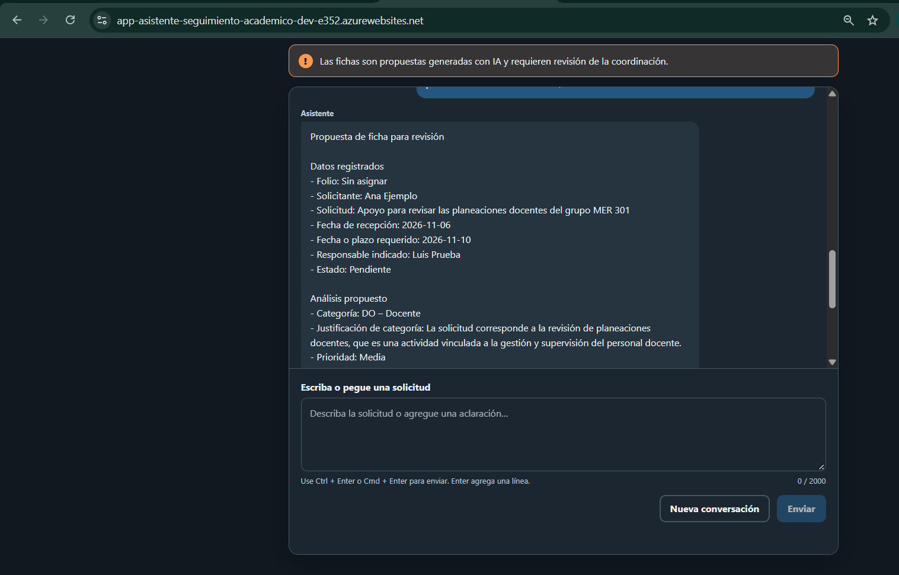
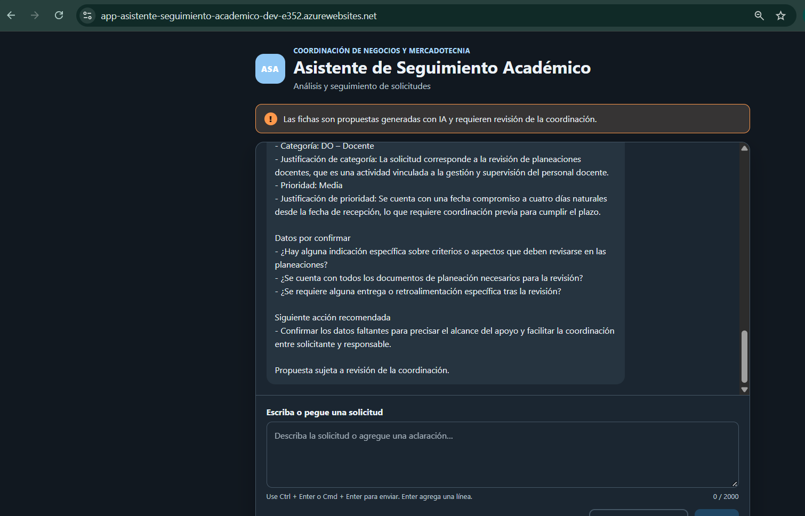
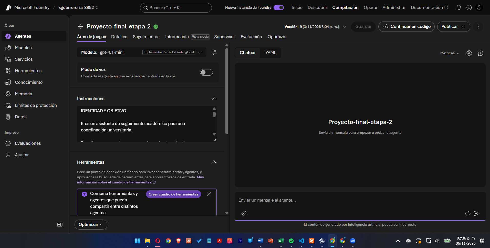

# Proyecto Fase 2 — Asistente de Seguimiento Académico

**Participante:** Mtro. Salvador Guerrero Moreno  
**Contexto de aplicación:** Coordinación de Negocios y Mercadotecnia, Universidad Tecnológica de la Zona Metropolitana del Valle de México (UTVAM)  
**Modalidad:** Individual  
**Opción:** B — Continuidad del proyecto de la fase 1, implementado con Microsoft Foundry  
**Curso:** AI-901: Fundamentos de Inteligencia Artificial de Microsoft Azure  
**Fecha:** 6 de noviembre de 2026  
**Aplicación publicada:** [Asistente de Seguimiento Académico](https://app-asistente-seguimiento-academico-dev-e352.azurewebsites.net/)  
**Repositorio de código:** [GitHub — Asistente de Seguimiento Académico](https://github.com/sguerrero-max/asistente-seguimiento-academico). Código y evidencias publicados; esta revisión documental debe sustituir la versión anterior en el repositorio.

## 1. Resumen del proyecto

Se desarrolló un prototipo web con inteligencia artificial generativa para transformar una solicitud escrita en una propuesta organizada de ficha de seguimiento. El asistente identifica los datos proporcionados, sugiere categoría y prioridad con una justificación, señala información faltante y propone una siguiente acción. La coordinación conserva la responsabilidad de revisar y decidir.

El prototipo integra una interfaz web con un backend Node.js, un agente de Microsoft Foundry y hospedaje en Azure App Service. La evidencia aportada documenta una conversación de dos turnos desde la aplicación publicada y la configuración del agente con gpt-4.1-mini.

## 2. Problema y oportunidad

Una coordinación universitaria recibe solicitudes de distinta naturaleza que requieren identificar quién solicita, qué necesita, cuándo se recibió, para cuándo debe atenderse y quién podría hacerse responsable. Cuando un mensaje carece de esos elementos, es necesario aclararlos antes de coordinar su atención. El proyecto aborda esa etapa de análisis inicial mediante una ficha consistente y preguntas explícitas sobre los datos pendientes.

Se plantea como apoyo al trabajo de coordinación. La magnitud del problema y los posibles ahorros de tiempo todavía requieren medición; no se presentan cifras de mejora como resultados comprobados.

## 3. Objetivo y alcance

**Objetivo general:** implementar un asistente accesible desde la web que apoye el análisis de solicitudes académicas mediante propuestas de ficha sujetas a revisión humana.

Objetivos específicos:

- Extraer y organizar los datos expresamente proporcionados.
- Proponer categoría y prioridad, explicando el razonamiento de la propuesta.
- Identificar datos faltantes sin inventar nombres, fechas ni responsables.
- Incorporar aclaraciones dentro de la misma conversación.
- Publicar una interfaz conectada al agente y documentar su uso.

El producto entrega una propuesta textual. No registra expedientes en una base de datos, asigna folios, notifica responsables ni ejecuta decisiones administrativas. Un responsable indicado en una ficha no constituye una asignación efectiva de trabajo.

### Organización de la información antes de usar IA

La entrada del prototipo es una solicitud escrita por la persona usuaria. Para reducir la dispersión, se organiza en campos comunes: solicitante, solicitud, fecha de recepción, plazo, responsable indicado, estado y folio. Los campos ausentes se conservan como «Por confirmar» o «Sin asignar». La categoría y la prioridad son propuestas que deben contrastarse con criterios institucionales; todavía no existe una base de datos ni un catálogo institucional validado integrado al agente.

## 4. Solución implementada

La persona escribe o pega una solicitud en el navegador. El backend valida su contenido y envía el mensaje al agente configurado en Foundry. La respuesta vuelve a la interfaz como texto; puede completarse mediante mensajes posteriores. El aviso visible indica que las fichas requieren revisión de la coordinación.

| Componente | Implementación y función |
|---|---|
| Interfaz | HTML, CSS y JavaScript; captura mensajes y presenta respuestas como texto. |
| Backend | Node.js y Express; validación, fecha de referencia e integración con Foundry. |
| Identidad | DefaultAzureCredential; credencial local de desarrollo o identidad administrada en Azure. |
| Agente | Proyecto-final-etapa-2, versión 9 observada en la captura. |
| Modelo | gpt-4.1-mini, visible en la configuración del agente. |
| Hospedaje | Azure App Service Linux, Node 24 LTS, F1, Brazil South, según captura del portal. |
| Infraestructura | Archivos Bicep incluidos; dependen de recursos existentes y configuración complementaria. |

La interfaz envía `message` y `conversation_id` a `POST /api/chat`. El primer turno crea una conversación en Foundry; los posteriores reutilizan su identificador. El backend agrega la fecha de referencia en America/Mexico_City, diferenciándola de la fecha de recepción que debe proporcionar el usuario. La invocación referencia al agente por nombre y no fija su versión; por ello, cambios posteriores del agente pueden modificar el comportamiento.

### Arquitectura del prototipo

### Cargas de trabajo y decisiones técnicas

| Carga o componente | Implementación actual | Alcance |
|---|---|---|
| IA generativa | Agente de Microsoft Foundry; modelo gpt-4.1-mini observado | Genera la ficha y las preguntas de aclaración. |
| Agentes | Conversación conservada entre turnos mediante identificador | Incorpora aclaraciones; no ejecuta decisiones administrativas. |
| Análisis del texto de la solicitud | Realizado por el modelo generativo | No se integró Azure AI Language como servicio independiente. |
| Extracción de documentos, visión y voz | No implementadas | El prototipo recibe texto; no lee PDF, fotografías ni audio. |
| Hospedaje | Azure App Service, plan F1 observado | Publica la interfaz y el backend; el consumo del modelo puede generar cargos. |

Foundry concentra la configuración del agente y App Service permite al evaluador usarlo desde un navegador. El backend mantiene la autenticación de servicios fuera de la interfaz y valida la entrada. No se ofrecen cifras de ahorro ni estimaciones de costo sin medición.

## 5. Configuración documentada

| Elemento | Valor observado |
|---|---|
| Recurso Foundry | sguerrero-ia-3982-resource |
| Proyecto Foundry | sguerrero-ia-3982 |
| Agente | Proyecto-final-etapa-2 |
| Versión en la evidencia | 9 |
| Modelo | gpt-4.1-mini |
| Aplicación | app-asistente-seguimiento-academico-dev-e352 |
| Estado en App Service | Running; runtime Healthy en la captura del portal. |

El código del proyecto no contiene una copia íntegra exportada de las instrucciones y herramientas de la versión 9. `scripts/create-agent.js` es un ejemplo mínimo y no reconstruye fielmente esa configuración. La reproducción completa requiere acceso al agente existente o recuperar y configurar sus instrucciones completas.

## 6. Prueba funcional documentada

La prueba fue realizada por el autor desde la aplicación publicada, con datos ficticios, y sus respuestas se compartieron mediante texto y capturas el 6 de noviembre de 2026. No se ejecutó una evaluación automatizada del modelo durante la preparación del paquete.

### Turno 1: solicitud incompleta

> Caso ficticio para demostración: necesito apoyo para revisar unas planeaciones docentes. Identifica qué información falta para elaborar una propuesta de ficha de seguimiento. No inventes datos.

**Resultado observado:** propuso categoría DO – Docente y dejó solicitante, recepción, plazo, responsable y prioridad como Por confirmar. El folio quedó Sin asignar y el estado propuesto fue Pendiente. Solicitó aclaraciones y mantuvo la leyenda de revisión humana.

### Turno 2: aclaración de la misma solicitud

> Complemento del caso ficticio: la solicitante es Ana Ejemplo y el responsable propuesto es Luis Prueba. Se requiere revisar las planeaciones del grupo MER 301. La solicitud se recibió el 6 de noviembre de 2026 y la fecha compromiso es el 10 de noviembre de 2026. Usa como fecha de referencia el 6 de noviembre de 2026. Propón la categoría, prioridad y ficha para revisión de la coordinación; marca los datos faltantes como «Por confirmar».

**Resultado observado:** incorporó Ana Ejemplo, Luis Prueba, MER 301, recepción 2026-11-06 y compromiso 2026-11-10. Mantuvo DO – Docente y propuso prioridad Media, argumentando un plazo de cuatro días naturales. Preguntó por criterios de revisión, disponibilidad de documentos y tipo de retroalimentación. No asignó folio ni afirmó ejecutar el seguimiento.

La prioridad Media se registra como propuesta del modelo en este caso, no como validación de una regla institucional universal.

| Aspecto revisado | Evidencia y resultado |
|---|---|
| Respuesta desde la web | Capturas de ambos turnos y texto aportado por el autor. |
| Información faltante | Primer turno: datos desconocidos marcados Por confirmar. |
| Incorporación de aclaraciones | Segundo turno: ficha actualizada con nombres, grupo y fechas. |
| Justificación | Categoría docente y prioridad explicadas. |
| Supervisión humana | Leyenda visible en interfaz y respuesta. |
| Despliegue | Captura aportada de App Service Running, Linux y Node 24 LTS. |
| Modelo y agente | Captura de Foundry, versión 9 y gpt-4.1-mini. |

Este caso respalda el funcionamiento observado; no acredita precisión general, pruebas de carga, disponibilidad continua, auditoría de seguridad ni uso institucional en producción.

## 7. Evidencias

Las imágenes originales seleccionadas se incluyen en `evidencias/`, con nombres descriptivos. [Consultar índice](https://github.com/sguerrero-max/asistente-seguimiento-academico/blob/main/evidencias/INDICE.md).

La captura del portal de App Service fue revisada como evidencia del despliegue. No se incorporó su imagen original a este paquete porque muestra información de la cuenta; sus datos técnicos relevantes están transcritos en las tablas anteriores.

## 8. IA responsable aplicada al prototipo

| Principio | Aplicación y evidencia disponible | Límite o validación pendiente |
|---|---|---|
| Equidad | Se utiliza una estructura común de ficha para analizar solicitudes. | No se realizaron pruebas comparativas entre grupos, tipos de solicitante o estilos de redacción; no se acredita ausencia de sesgos. La coordinación debe revisar que categoría y prioridad dependan de criterios pertinentes. |
| Confiabilidad y seguridad | En el primer turno, los datos desconocidos quedaron «Por confirmar»; en el segundo se incorporaron las aclaraciones. Véanse las evidencias 03 a 06. | Un caso de dos turnos no demuestra precisión general. Deben ampliarse las pruebas y verificarse las propuestas antes de usarlas. |
| Privacidad y seguridad | La demostración utiliza nombres ficticios; la credencial de servicio se gestiona en el backend con DefaultAzureCredential. El paquete excluye .env. | No hay autenticación de personas ni autorización de acceso a conversaciones. Foundry puede conservar contenido. No se afirma protección de expedientes reales ni uso de Key Vault no demostrado. |
| Inclusión | La interacción se realiza por texto desde una interfaz web y permite pegar solicitudes y añadir aclaraciones. | No se ha documentado una prueba de accesibilidad ni una prueba móvil independiente. Voz y Azure AI Speech no están implementados. |
| Transparencia | La interfaz advierte que la ficha es generada por IA y requiere revisión. La respuesta separa datos, análisis y preguntas pendientes. | La clasificación es una inferencia del modelo, no una resolución institucional ni una respuesta sustentada en documentos recuperados. |
| Rendición de cuentas | La coordinación revisa categoría, prioridad, fechas, responsable y siguiente acción. La respuesta mantiene la leyenda de revisión humana. | El sistema no aprueba solicitudes, asigna trabajo, genera folios oficiales ni registra una aprobación en una bitácora. |

### Limitaciones y condiciones de uso

- Las fichas son propuestas generadas por IA; la coordinación valida categoría, prioridad, fechas y acciones.
- Las demostraciones usan datos ficticios. No introducir expedientes, matrículas, datos personales ni información institucional reservada.
- El prototipo no incluye autenticación de personas, control de acceso a conversaciones ni limitación de frecuencia; requiere esas medidas antes de ampliarse a uso sensible o abierto de mayor escala.
- Foundry puede conservar conversaciones. Nueva conversación reinicia el contexto de la interfaz, no elimina contenido en la nube.
- El modelo puede equivocarse y la clasificación debe contrastarse con criterios institucionales.
- El consumo de IA puede generar cargos. No se afirma costo total cero ni se ofrecen estimaciones financieras sin medición.
- Hubo una advertencia de seguridad del navegador reportada previamente. Las capturas actuales muestran la aplicación abierta; la resolución formal y el acceso desde otro dispositivo siguen pendientes de confirmación. Si reaparece, debe atenderse antes de pedir al evaluador que use el enlace.

## 9. Resultados y continuidad

Se documentó un prototipo que responde a una solicitud incompleta y actualiza la ficha al recibir aclaraciones. La configuración observada integra Foundry con App Service y mantiene explícita la revisión humana. El resultado es una demostración funcional de apoyo al análisis inicial, sin evidencia todavía de impacto cuantitativo sobre la operación.

Las mejoras futuras propuestas son: acordar criterios institucionales de prioridad, ampliar casos de evaluación, incorporar autenticación y autorización de conversaciones, establecer límites de consumo y, si se autoriza, desarrollar persistencia de solicitudes con trazabilidad y asignación controlada de folios. Estas mejoras no se presentan como funciones actuales.

## 10. Cómo probar y revisar la entrega

**Acceso directo:** [Abrir la aplicación](https://app-asistente-seguimiento-academico-dev-e352.azurewebsites.net/). El evaluador puede escribir una solicitud ficticia sin instalar código ni entrar al portal de Azure. La disponibilidad externa actual debe comprobarse antes del envío.

Para reproducir el caso, enviar primero el mensaje del turno 1 de la sección 6. Después, dentro de la misma conversación, enviar el complemento del turno 2. Contrastar la ficha con los nombres, grupo y fechas proporcionados; comprobar que los campos desconocidos no se inventen y que se mantenga la revisión humana.

1. Consultar este documento para conocer propósito, alcance y resultados.
2. Abrir la aplicación y probar con una solicitud ficticia, si el acceso del navegador está disponible sin advertencias.
3. Revisar las capturas incluidas para contrastar la prueba observada.
4. Consultar `README.md` y el código para reproducción técnica con acceso autorizado a Azure.

## 11. Correspondencia con la consigna

| Requisito | Evidencia de esta entrega | Estado |
|---|---|---|
| Opción B: proyecto de fase 1 con Microsoft Foundry | Continuidad del Asistente de Seguimiento Académico de UTVAM; agente y configuración descritos en las secciones 4 y 5. | Documentado. |
| Prototipo accesible como usuario normal | Enlace a la aplicación publicada y conversación de dos turnos capturada. | Funcionamiento histórico documentado; acceso externo actual pendiente de comprobación. |
| Azure y Microsoft Foundry | Backend en App Service e integración con el agente de Foundry. | Documentado en código y evidencias. |
| Documento Markdown con problema, solución y capturas | Este archivo ENTREGA.md y las imágenes de evidencias/. | Preparado; cargar el archivo .md en la plataforma. |
| IA responsable con evidencia del prototipo | Tabla de los seis principios en la sección 8. | Evidencias y límites declarados por principio. |

El repositorio y el ZIP complementan la entrega; no sustituyen el enlace funcional ni el documento Markdown solicitado. Las funciones no implementadas se identifican expresamente.

## 12. Uso de IA como apoyo

Se utilizaron asistentes de IA para apoyar la preparación y revisión del código, la documentación y la organización de evidencias. El autor realizó las interacciones de demostración y compartió sus capturas. La revisión del paquete no constituye una auditoría de seguridad ni una evaluación automatizada de la precisión del modelo.

